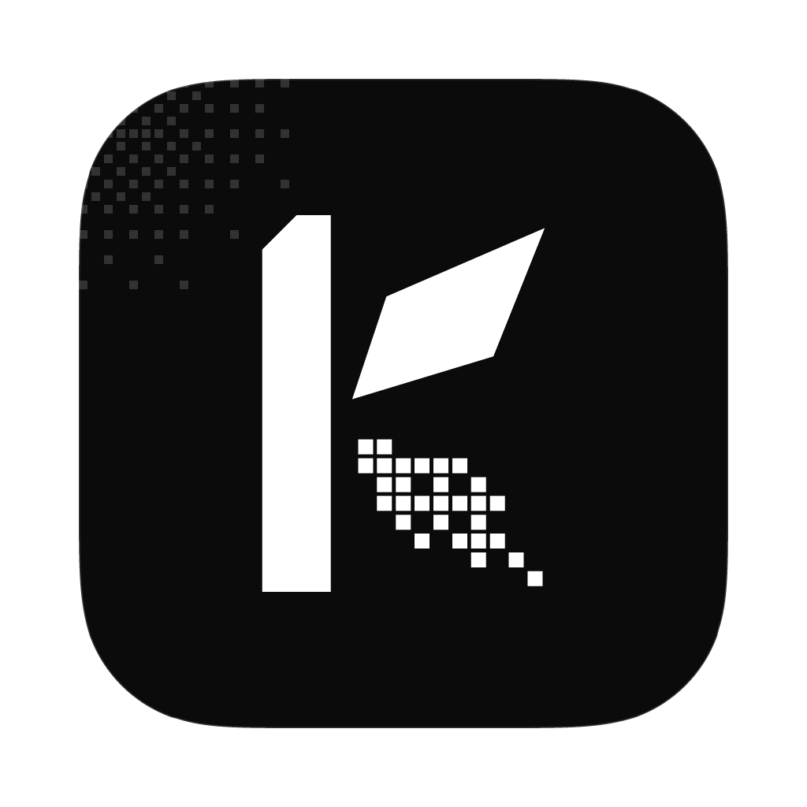

<p align="center">
  
</p>

<h1 align="center">kimchi</h1>

<p align="center">An open-source video editor where generative models are part of the cut, drivable end to end by your AI agent.<br/>
Part of <a href="https://lsuite.xyz">lsuite</a> · <a href="https://lsuite.xyz/kimchi">lsuite.xyz/kimchi</a></p>

**Status:** Beta · v0.12.0 · Linux and macOS

<picture>
  <source media="(prefers-color-scheme: light)" srcset="https://lsuite.xyz/assets/img/kimchi/editor-light.webp">
  
</picture>

## What it does

kimchi is a native desktop video editor, written in Rust, for people who edit video and want
image and video generation models inside the edit rather than in a separate tool. Prompt a shot
straight onto the timeline, animate a frame you like, extend a clip from its last frame or bridge
two shots with a generated transition, then cut, trim and export it like any other footage.

- **Editing**: a multi-track timeline, transitions, colour and LUTs, keyframes, captions
  transcribed on your computer, and export to MP4, HEVC, ProRes, WebM, GIF or audio.
- **Motion graphics and 3D**: an After Effects-like 2D compositor and a Blender-like 3D scene with
  modelling, modifiers, a GPU renderer and a path tracer, plus templates and expressions.
- **Sound**: a Rust mixer with buses, automation and loudness, sharing
  [ryolune](https://github.com/ludovic111/ryolune)'s effects and plugin host (CLAP, VST3, Audio
  Units on macOS).
- **Generation**: images, video, speech and sound from cloud providers (OpenRouter, fal,
  Replicate, Runway, Luma and more) or local ones (ComfyUI, Ollama, Stable Diffusion WebUI).
  You bring your own keys, kept in the system keychain, or run everything locally. Every
  generated asset keeps its prompt, model and seed.
- **Coming from another editor**: opens and writes OpenTimelineIO, FCPXML, Premiere XML and EDL,
  imports LUTs and presets, and offers the keyboard layouts of nine other editors.
- **Driven by AI**: every action is one of more than 250 named commands, shared by the window, the
  built-in agent, `kimchi-cli` and `kimchi-mcp`, with one undo history. The agent looks at the
  frames it renders and fixes what looks wrong.

The full list is in [docs/FEATURES.md](docs/FEATURES.md).

## Getting it

Get kimchi in the [lsuite app](https://lsuite.xyz/launcher), the suite's free launcher: it
installs kimchi and keeps it up to date, with no account.

| System | What the lsuite app installs |
| --- | --- |
| Linux (x86-64) | the AppImage (`kimchi_amd64.AppImage`) |
| macOS, Apple silicon and Intel | the app bundle, signed with a Developer ID and notarized by Apple |
| Windows | Coming soon |

Each release also builds a Debian package (`kimchi_amd64.deb`) and macOS disk images (`.dmg`).
ffmpeg, `kimchi-cli` and `kimchi-mcp` are bundled. kimchi checks for updates itself and verifies
each update's signature before replacing anything (see [Settings › Updates](docs/guide/settings.md#updates)).

### Building from source

You need Rust 1.92 or later; on Linux, the development packages listed in
[docs/DEVELOPMENT.md](docs/DEVELOPMENT.md#setting-up). In development kimchi uses the ffmpeg on
your `PATH`.

```bash
cargo run -p kimchi             # the desktop app
cargo run -p kimchi-cli -- help # the CLI
cargo test --workspace
```

## Usage

The [user guide](docs/guide/README.md) walks through the window, from a first cut to motion
graphics, sound, generation and export. To drive kimchi from an agent or a script:

```bash
claude mcp add kimchi -- /path/to/kimchi-mcp --live      # Claude Code; `kimchi-cli mcp-config` prints the path
kimchi-cli project.overview                              # the running app
kimchi-cli --file cut.json clip.addText text="Opening title"   # a project file, without the window
```

The built-in **Agent** panel (⌘J) runs the model you already have: Claude Code, Codex, Gemini
CLI, an Anthropic, OpenAI, Google Gemini or Amazon Bedrock key, any OpenAI-compatible service, or
a local Ollama model. What agents may do is set in Settings › Agent.

**Plugins** are written in Rust with kimchi's SDK (`crates/kimchi-plugin`); kimchi also loads
frei0r filters, LUTs and ryolune's sound plugins, and the agent can build a plugin for you
([docs/PLUGINS.md](docs/PLUGINS.md)).

## Documentation

- [User guide](docs/guide/README.md) and [keyboard shortcuts](docs/guide/shortcuts.md)
- [Features](docs/FEATURES.md) and supported [models and providers](docs/FEATURES.md#models)
- [Controlling kimchi from AI and scripts](docs/AI_CONTROL.md) and the [command reference](docs/COMMANDS.md)
- [Switching from another editor](docs/SWITCHING.md) and [what kimchi reads and writes](docs/COMPATIBILITY.md)
- [Configuration](docs/CONFIGURATION.md), [the project file](docs/PROJECT_FORMAT.md) and [plugins](docs/PLUGINS.md)
- [Architecture](docs/ARCHITECTURE.md), [development](docs/DEVELOPMENT.md) (building, testing, packaging, releases) and [performance](docs/PERFORMANCE.md)
- [Changelog](CHANGELOG.md), and everything else in [docs/README.md](docs/README.md)

## Project status and roadmap

kimchi is in beta: v0.12.0 (2026-10-11) is released for Linux (x86-64) and macOS (Apple silicon
and Intel). Known limits:

- **Windows is not built yet.** Its code and packaging script stay in the source; the release
  workflow's Windows line is switched off until it ships.
- **The Debian package does not update itself**: kimchi says an update is out and points to the
  lsuite app. The AppImage and the macOS app update in place.
- **Generation needs a provider**: an API key for a cloud service, or a local server such as
  ComfyUI or Ollama. Nothing is generated without one.
- **Some commands need the running window** (playback, selection, panels, screenshots and the
  built-in agent): `kimchi-cli --file` and `--headless` refuse them. An MCP server handles one
  request at a time ([details](docs/AI_CONTROL.md#limits)).
- **Agent evaluations are not yet run for every release**: the 12 jobs in `evals/` were last run
  in full on 2026-10-08, for 0.11.0 (11 passed; the failure was the scorer's, since fixed). The
  Codex agent provider has not been tested.

Next: Windows builds, and the full evaluation suite run before each release. What changed in
each version is in the [changelog](CHANGELOG.md).

## Contributing

Bug reports and suggestions are welcome as [GitHub issues](https://github.com/ludovic111/kimchi/issues);
Report a problem (in the command palette, or Help on macOS) opens one with your version and
system filled in. Before
opening a pull request, read [docs/DEVELOPMENT.md](docs/DEVELOPMENT.md) and run
`cargo test --workspace`.

## Origins

kimchi began as a fork of [OpenCut](https://github.com/OpenCut-app/OpenCut), the open-source
video editor started by Maze Winther, and keeps OpenCut's git history: the earlier commits and
their many contributors are OpenCut's. In October 2026 the code was replaced by a new
implementation in Rust, from which kimchi has grown since. OpenCut's MIT copyright notice is kept
in [LICENSE](LICENSE).

## Licence

[MIT](LICENSE). The bundled ffmpeg is distributed under its own licence (GPL), included in the
app as `FFMPEG-LICENSE.txt`. Fonts: Chakra Petch, IBM Plex Mono, Manrope, Instrument Sans and
Instrument Serif, under the SIL Open Font License (`OFL.txt` beside each in
`crates/kimchi-desktop/fonts/` and `crates/kimchi-media/fonts/`). Icons: Lucide (ISC,
`crates/kimchi-desktop/assets/icons/LICENSE.lucide.txt`). The logos of other services and apps
are the trademarks of their owners, used only to identify them
([SOURCES.md](crates/kimchi-desktop/assets/logos/SOURCES.md)).

---

Made by [Ludovic Marie](https://lu4ovic.com) · [GitHub](https://github.com/ludovic111)
